# AIDE – AI-Assisted Engineering of Industrial Digital Twins

This repository contains the implementation of the AI-Assisted DT Engineering Tool (AIDE), presented in the paper
*"AI-Assisted Engineering of Industrial Digital Twins"*.

Engineering a digital twin (DT) means binding service requirements to the OPC UA interface of a
machine, turning the fault rules of domain experts into executable watchdogs, and configuring
dashboards for operators. AIDE generates these artifacts with an LLM and validates them with
deterministic checks, so the DT engineer only resolves the cases the LLM cannot repair and approves
the results.

**Demo video:** [AIDE on YouTube](https://youtu.be/hKjXZ0aXCAo) walks through AIDE end to end.

<p align="center">
  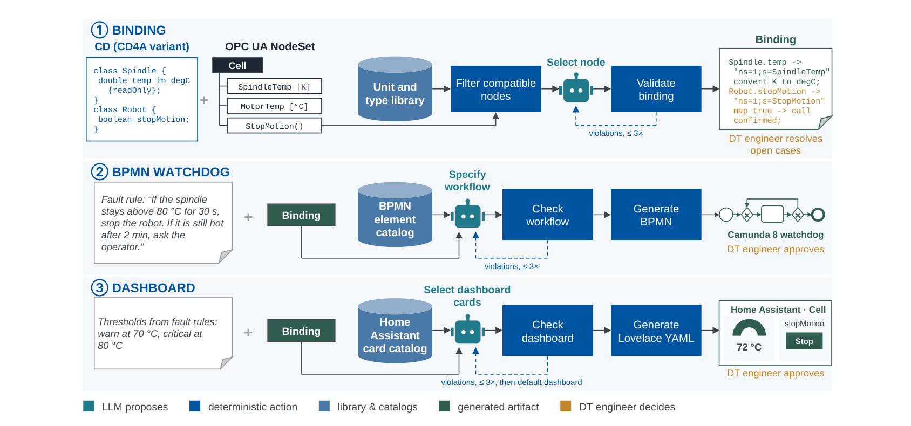
</p>

AIDE supports three activities:

- **Binding:** maps the attributes of a class diagram to OPC UA nodes. A compatibility filter only
  offers nodes whose access, type and unit fit.
- **BPMN watchdogs:** turns natural-language fault rules into BPMN watchdogs that Camunda 8 executes.
- **Dashboard:** selects Home Assistant cards for the bound values, with critical ranges taken from
  the fault rules.

In each activity, the checks return their violations to the LLM, which gets up to three revisions.
The DT engineer then approves the artifact, and AIDE deploys it to the running digital twin.

## Repository Organization

- `frontend`: web front end (React, bpmn-js) that guides through the five steps.
- `backend`: FastAPI backend with the LLM calls, the review and approval logic and the deployment.
- `languages`: MontiCore languages (binding, watchdog, dashboard), compatibility filter, context
  conditions and BPMN generator. `languages/prebuilt/dtlang.jar` holds the compiled languages.
- `adapter`: runtime adapter between OPC UA, Camunda 8 and Home Assistant (via MQTT).
- `opcua_simulator`: OPC UA simulation server built from a NodeSet, with timed fault scenarios.
- `examples`: three runnable use cases: the ABB YuMi robot, a machine-tending cell and a 5-axis
  milling machine.
- `docker`: configuration of Mosquitto, Home Assistant and Camunda; the stack is defined in
  `compose.yaml`.
- `docs`: the figures, the [development document](docs/development_document.md) and the
  [simulator scenarios](docs/simulator_scenarios.md).

## Getting Started

### Prerequisites

- Git and [Docker Desktop](https://www.docker.com/products/docker-desktop/) (or Docker Engine with
  the Compose plugin). Start Docker before the next steps. No host installation of Python, Java,
  Node or Camunda is needed.
- At least 6 GB of free memory and a few GB of disk space. The first build downloads the images,
  the MontiCore libraries and the application dependencies; allow several minutes.
- An API key from [Groq](https://console.groq.com/keys), [NVIDIA](https://build.nvidia.com) or
  [Mistral](https://console.mistral.ai/). The binding, watchdog and dashboard steps call the LLM API.
- Free local ports 1883, 3100, 4841–4843, 8100, 8123, 8180, 9600 and 26500. Stop other stacks that
  use them, for example containers of an earlier version of this repository.

### Steps

The whole stack runs from `compose.yaml`; no manually created files are needed. The containers
create their state (`generated/`, the Home Assistant configuration, the MQTT passwords) on the
first start.

1. Get the repository:

   ```bash
   git clone https://github.com/iswunistuttgart/AIDE_AI_Assisted_DT_Engineering.git
   cd AIDE_AI_Assisted_DT_Engineering
   ```

2. Copy the configuration template to `.env` and open it in an editor:

   Windows (PowerShell):

   ```powershell
   Copy-Item .env.example .env
   notepad .env
   ```

   Windows (Command Prompt):

   ```bat
   copy .env.example .env
   notepad .env
   ```

   macOS and Linux:

   ```bash
   cp .env.example .env
   ```

   Then enter your API key and save the file:

   ```ini
   AI_PROVIDER=groq        # or mistral, nvidia
   GROQ_API_KEY=<your key> # or MISTRAL_API_KEY, NVIDIA_API_KEY
   ```

   | Variable | Value |
   |---|---|
   | `AI_PROVIDER` | `groq` (default), `mistral` or `nvidia` |
   | `GROQ_API_KEY` | Your Groq API key (required when `AI_PROVIDER=groq`) |
   | `MISTRAL_API_KEY` | Your Mistral API key (required when `AI_PROVIDER=mistral`) |
   | `NVIDIA_API_KEY` | Your NVIDIA API key (required when `AI_PROVIDER=nvidia`) |
   | `AI_MODEL` | Model for all LLM steps; empty means `openai/gpt-oss-120b` (Groq), `nvidia/nemotron-3-ultra-550b-a55b` (NVIDIA) or `ministral-14b-2512` (Mistral) |
   | `AI_TIMEOUT_SECONDS`, `AI_MAX_OUTPUT_TOKENS` | Limits of one LLM call |

   Do not share `.env`; it contains your API key. Without a key the stack still starts and the
   examples can be deployed with their reference solutions, but the LLM steps report the missing
   key.

3. Build and start the stack. This takes several minutes on the first run:

   ```bash
   docker compose up -d --build --wait
   ```

   The command builds and starts all services and waits until they are healthy. On the first start
   it also creates a random password for each MQTT account and keeps it in the Docker volume
   `mqtt_secrets`. The build uses the compiled MontiCore languages in
   `languages/prebuilt/dtlang.jar`, so it does not need the MontiCore repository. After changing
   `languages/`, rebuild the jar as described in
   [Rebuilding the MontiCore languages](#rebuilding-the-monticore-languages).

4. Open the tools. All ports bind to the local computer only.

   | Service | URL / login |
   |---|---|
   | AIDE | <http://localhost:3100> |
   | Backend API | <http://localhost:8100/docs> |
   | Home Assistant | <http://localhost:8123>. Create a local account on the first visit, then open **Digital Twin** in the sidebar. |
   | Camunda Operate and Tasklist | <http://localhost:8180/operate>, <http://localhost:8180/tasklist> (`demo` / `demo`) |
   | OPC UA simulators | `opc.tcp://localhost:4841/robot-cell/`, `opc.tcp://localhost:4842/milling-machine/`, `opc.tcp://localhost:4843/yumi/` (desktop OPC UA client) |
   | MQTT | `mqtt://localhost:1883` (user `observer`, read-only; password: `docker compose exec mosquitto cat /run/mqtt-secrets/observer`) |

To stop the stack, run `docker compose down`; data and volumes are kept. To start again from a
clean state, run `docker compose down -v` and delete `generated/` and every file in
`docker/homeassistant/` except `configuration.yaml` and `.gitignore`.

## Use Case: YuMi Tic-Tac-Toe

This use case shows how to work with AIDE. An ABB YuMi robot plays tic-tac-toe. Its OPC UA
interface provides the state of the robot, the motor temperatures of seven axes and the methods
`PlaceX(cell)`, `PlaceO(cell)`, `ClearBoard`, `Stop` and `Start`. A simulator in the stack plays
the role of the robot. The step-by-step walkthrough below follows the
[demo video](https://youtu.be/hKjXZ0aXCAo), and the screenshots come from it. The files of the
use case are in `examples/yumi_tictactoe/`.

### Inputs

The DT engineer gives AIDE three inputs, which AIDE loads in step 1:

| File | Role | Format |
|---|---|---|
| `requirements.cd` | Service requirements: what the monitoring service reads and writes | Class diagram in a variant of MontiCore CD4A (see below) |
| `yumi-tictactoe.nodeset.xml` | OPC UA interface of the robot: nodes, data types, units and methods | OPC UA NodeSet2 XML |
| `fault-rules.md` | Fault rules of the domain experts in natural language | Markdown or plain text |

The folder also holds the description of the example for AIDE and the reference solutions of the
three artifacts that AIDE generates with the LLM:

| File | Role | Format |
|---|---|---|
| `example.json` | Title, position in the list, NodeSet file and simulator endpoint | JSON |
| `simulation.json` | Behavior of the simulator: noise, effects of writes and method calls, scenarios | JSON |
| `binding.bind` | Reference binding: attribute → OPC UA node | AIDE binding language |
| `watchdog.wf` | Reference watchdogs, from which AIDE generates BPMN | AIDE watchdog language |
| `dashboard.dash` | Reference dashboard for Home Assistant | AIDE dashboard language |

#### Service requirements (`.cd`)

The service requirements are a class diagram in a variant of **CD4A** (CD4Analysis, the class
diagram language of MontiCore). The grammar `languages/src/main/grammars/de/aide/ServiceRequirements.mc4`
extends CD4Analysis by two parts of an attribute:

- `in <unit>` states the unit of the value, for example `in degC`. The compatibility filter only
  offers nodes with a fitting unit.
- `{readOnly}` marks an **input** that the service only reads. Every other attribute is an
  **output** that the service may write, for example to call a method of the machine.

```text
classdiagram YumiMonitoring {

  class Robot {
    String state {readOnly};
    boolean clear;
    boolean stop;
    boolean restart;
    int nextX;
    int nextO;
  }

  class Axis3 {
    double motorTemperature in degC {readOnly};
  }
}
```

In the YuMi, `Robot.state` and `Axis3.motorTemperature` are inputs. `clear`, `stop` and `restart`
are Boolean outputs that the binding maps to the methods `ClearBoard`, `Stop` and `Start` (setting
them to `true` calls the method). `nextX` and `nextO` pass the target cell to `PlaceX` and `PlaceO`.

#### Fault rules (`.md`)

The fault rules describe in natural language when a watchdog reacts and how. AIDE writes one
watchdog per numbered rule, and the checks trace every rule to a watchdog:

```markdown
1. Motor overheating: If the motor temperature of axis 3 rises above 80 °C, call stop, and
   call start once the temperature falls below 60 °C.

2. Error state: If the robot reports an error state, call stop and ask the operator whether
   to call clearBoard and start.

3. Move not completed: If no move completes within 30 seconds after placeX or placeO, call
   stop and escalate to the operator.
```

### Walkthrough

The steps follow the demo video. Open [AIDE](http://localhost:3100) and work through the five
panels from top to bottom. The subtitle shows the configured model; an API or network failure
appears as a red system error above the panels. The other examples work the same way (see
[Other examples](#other-examples)).

#### Step 1: Specify

1. In the **Specify** panel, choose **YuMi tic-tac-toe** in the list at the top right.
2. Click **Load example**.

AIDE loads the three inputs: the service requirements `requirements.cd`, the OPC UA NodeSet
`yumi-tictactoe.nodeset.xml` and the fault rules `fault-rules.md`. Below them it reports
*Example loaded: YuMi tic-tac-toe* and *30 nodes in the NodeSet*. To use your own model, click
**Upload** under each of the three boxes instead.

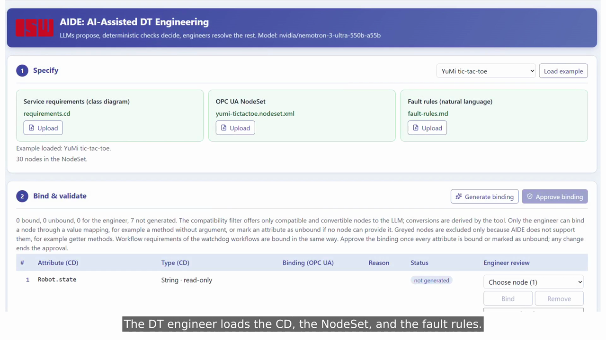

#### Step 2: Bind & validate

1. In the **Bind & validate** panel, click **Generate binding**. All seven attributes start as
   *not generated*; the LLM binds each one to a node that the compatibility filter offers.
2. Wait until the summary reads *4 bound, 0 unbound, 3 for the engineer*. The LLM has bound
   `Robot.state`, `Robot.nextX`, `Robot.nextO` and `Axis3.motorTemperature`. The three rows
   `Robot.clear`, `Robot.stop` and `Robot.restart` stay open with the status **engineer** and the
   reason *No candidate*, because no node has a fitting type: these Boolean attributes can only be
   bound to a method through a value mapping.

   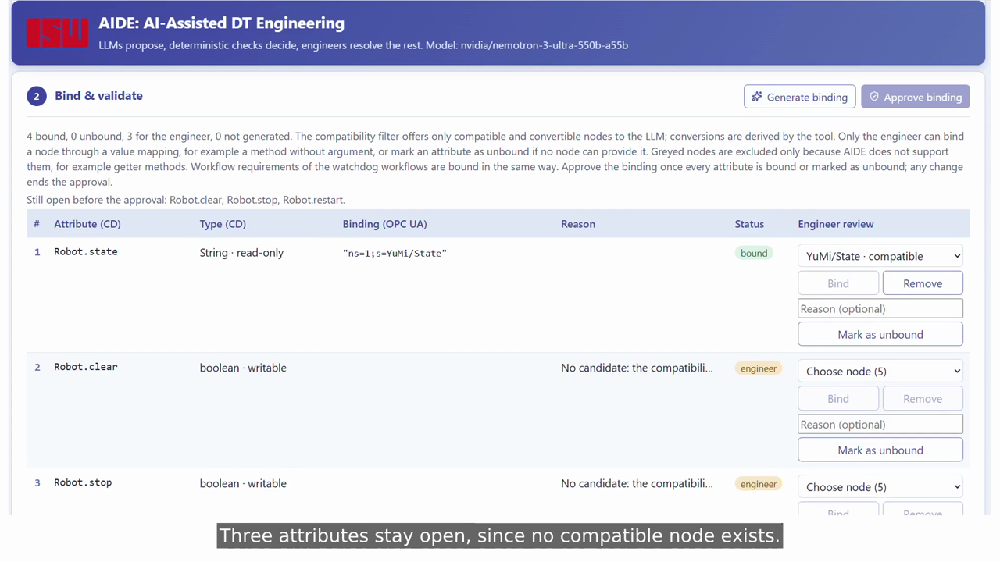

3. Resolve the three open rows. In the column **Engineer review** of each row, open the list
   **Choose node (5)**. Under *Only through a value mapping*, choose the node below and click
   **Bind**:

   | Row | Attribute | Node to choose |
   |---|---|---|
   | 2 | `Robot.clear` | `YuMi/ClearBoard · map true -> call` |
   | 3 | `Robot.stop` | `YuMi/Stop · map true -> call` |
   | 4 | `Robot.restart` | `YuMi/Start · map true -> call` |

   Choosing such a node confirms the mapping: setting the attribute to `true` calls the method.
   Do not choose `PlaceX` or `PlaceO`, which are also offered.

   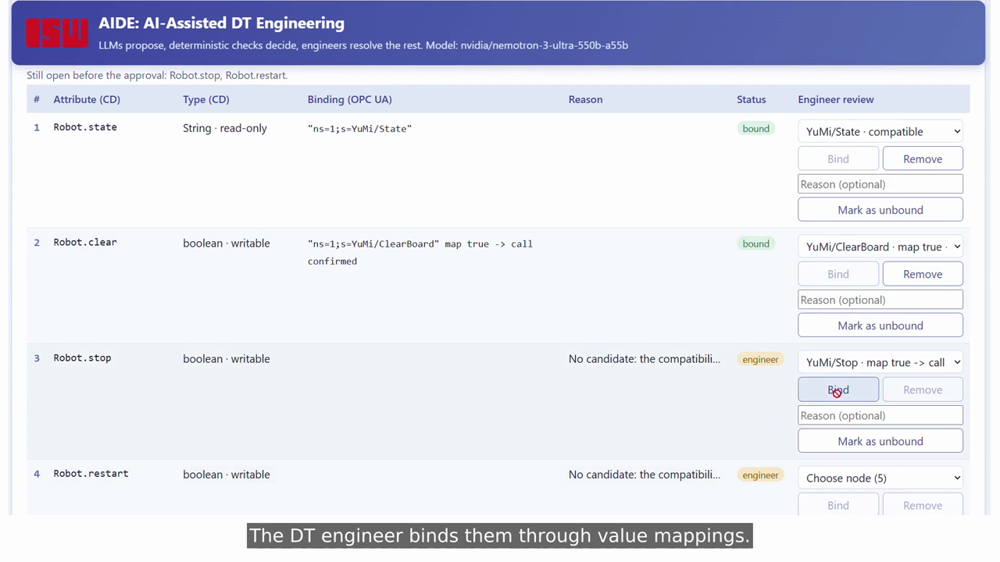

4. Check the rows the LLM bound: `Robot.state` → `YuMi/State`, `Robot.nextX` → `YuMi/PlaceX`,
   `Robot.nextO` → `YuMi/PlaceO`, `Axis3.motorTemperature` → `YuMi/Axis3/MotorTemperature`. The
   checks accept any node with a fitting type and unit, so the LLM may choose, for example, the
   temperature of another axis. To correct a row, choose the right node and click **Bind**.
5. Once the summary reads *7 bound, 0 unbound, 0 for the engineer*, click **Approve binding**. The
   button changes to **Binding approved**.

   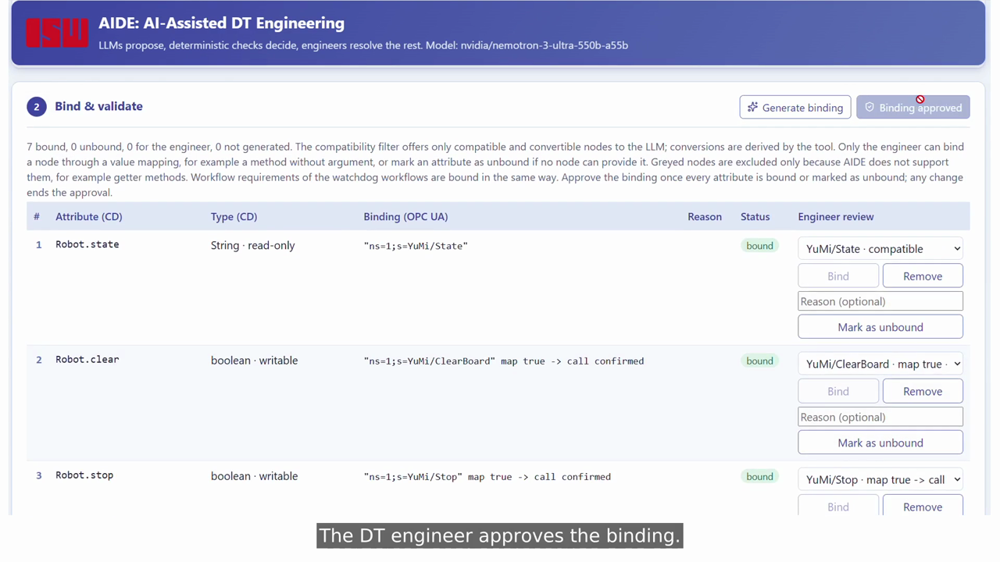

6. Below the table, AIDE shows the generated artifact of this step: the binding model with all
   seven bindings. The row numbers of the table appear in front of its lines. `map true -> call
   confirmed` marks a value mapping that you confirmed in item 3.

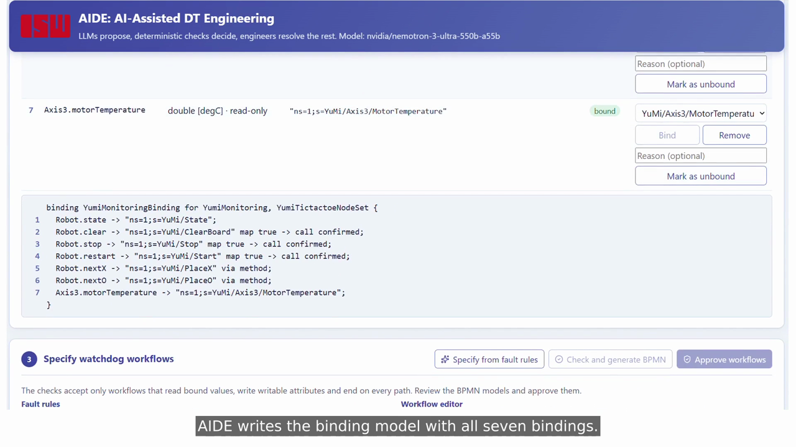

**Remove** turns a bound attribute back into an open case. If the machine cannot provide a value,
enter an optional reason and click **Mark as unbound** instead of binding a node. Any later change
of the binding ends the approval. The reference binding is `examples/yumi_tictactoe/binding.bind`.

#### Step 3: Specify watchdogs

1. In the **Specify watchdog workflows** panel, the fault rules of the YuMi are on the left:
   *1. Motor overheating*, *2. Error state* and *3. Move not completed*. Click
   **Specify from fault rules**. The LLM writes one watchdog per fault rule. The progress box shows
   the round (*Round 1 of at most 4: The LLM writes the workflows*, then *The checks run*) and the
   state of each rule. The checks accept only watchdogs that read bound values, write writable
   attributes and end on every path; their findings go back to the LLM.

   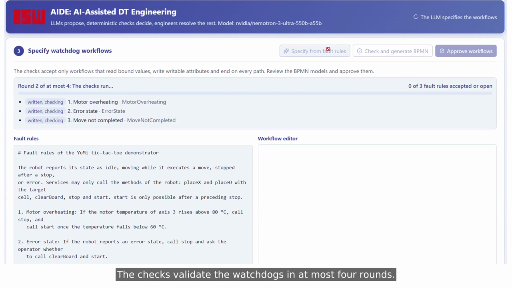

2. Wait until the **Workflow editor** on the right shows the three watchdogs `MotorOverheating`,
   `ErrorState` and `MoveNotCompleted`, and AIDE draws one BPMN diagram per watchdog below.
3. Review the BPMN diagrams. Each caption states the fault rule that the watchdog covers and its
   path, for example *MotorOverheating covers fault rule 1: set Robot.stop = true → set
   Robot.restart = true → escalate "Motor temperature not falling below 60 °C"*. If you edit the
   text, click **Check and generate BPMN**.
4. Click **Approve workflows**.

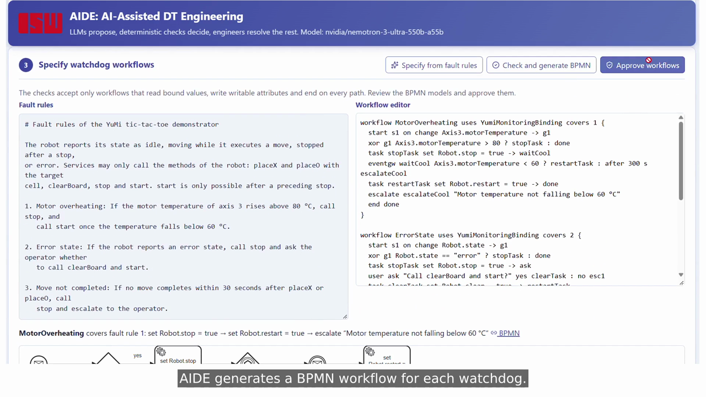

A value that the service lacks becomes a workflow requirement, which the tool binds and lists in
the binding table; approve the binding again after such a change. The reference solution is
`examples/yumi_tictactoe/watchdog.wf`.

#### Step 4: Specify dashboard

1. In the **Specify dashboard** panel, click **Specify with the LLM**. The LLM selects cards from the
   Home Assistant card catalog: a tile for `Robot.state`, a gauge and a history for
   `Axis3.motorTemperature`, buttons for `stop`, `restart` and `clear`, inputs for `nextX` and
   `nextO`, and one alarm per watchdog. If the checks still reject the dashboard after three
   revisions, the tool writes the default dashboard with one card per bound attribute.
2. If you edit the text, click **Check dashboard**. The checks confirm, among other things, that
   every control asks for confirmation.
3. Review the **Preview of the dashboard** below the editor.
4. Click **Approve dashboard**. The button changes to **Dashboard approved**.

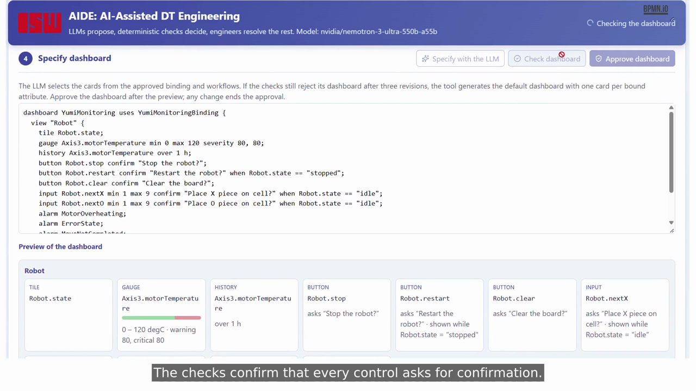

The reference solution is `examples/yumi_tictactoe/dashboard.dash`.

#### Step 5: Deploy & monitor

1. In the **Deploy & monitor** panel, keep the **OPC UA endpoint**
   `opc.tcp://opcua-yumi:4840/yumi/` of the YuMi simulator and the **Simulator scenario** `idle`.
2. Click **Deploy**. AIDE sends the three BPMN watchdogs to Camunda 8, configures the adapter and
   writes the Home Assistant dashboard. The panel then reports *Deployed …: 7 bindings, 3 watchdog
   workflows*, the adapter as *connected* and each watchdog as *monitoring*.

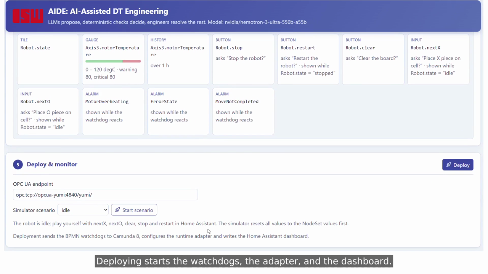

#### Step 6: Play in Home Assistant

1. Click the link **Home Assistant dashboard** in the panel, or open
   [Home Assistant](http://localhost:8123) and click **Digital Twin** in the sidebar. The dashboard
   shows the **Status** (state, motor temperature), the **Trend** and the **Controls**.

   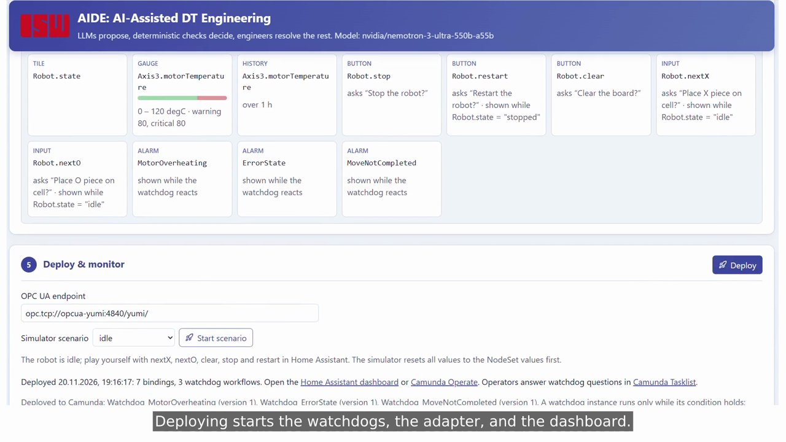

2. Under **Next X**, click a cell, for example **1**, and confirm the question. The state changes to
   `moving` and returns to `idle` after 4 s; *MoveNotCompleted* ends without an alarm.

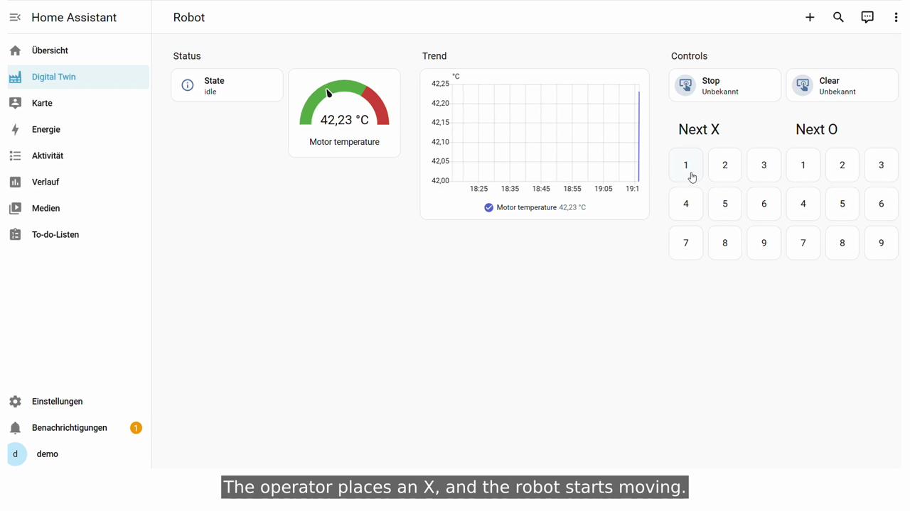

Every control that calls a method asks for confirmation first. The restart button appears only
while the robot is stopped, and **Next X** and **Next O** only while it is idle.

#### Step 7: Error state and Camunda Tasklist

1. While the robot still moves, click under **Next O** the cell that is already taken, for example
   **1**, and confirm. The robot rejects the move and reports the state `error`.
2. The watchdog *ErrorState* calls `Stop` (state `stopped`). Its alarm card appears under
   **Status** with *waiting for operator: Call clearBoard and start?*. Click the card to see its
   history.

   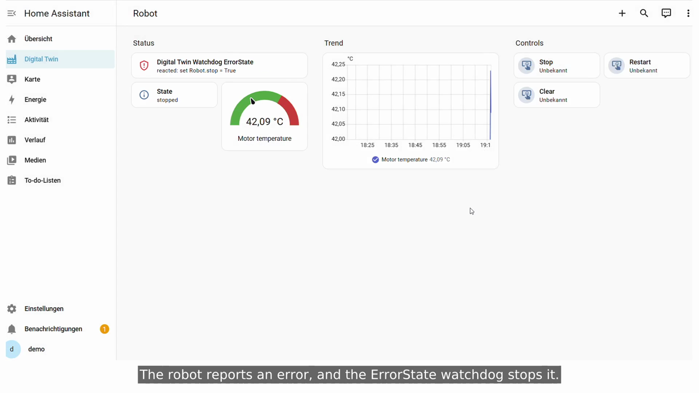

3. Open [Camunda Tasklist](http://localhost:8180/tasklist) and log in with `demo` / `demo`.
4. Click the task **Call clearBoard and start?** (*Watchdog ErrorState*), click **Assign to me**
   (*Mir zuweisen*), choose **Yes** and click **Complete task** (*Aufgabe abschließen*).

   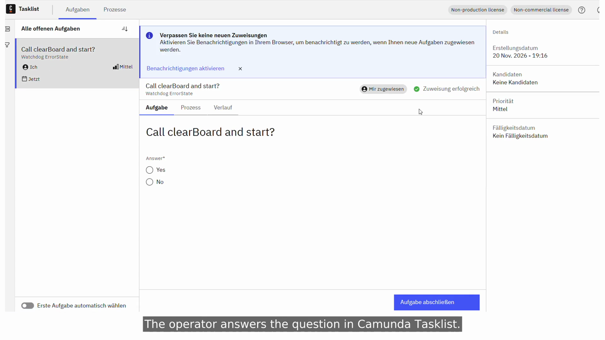

5. Back in Home Assistant, the alarm card shows *Reacted: set Robot.clear = True* and *Reacted: set
   Robot.restart = True*: the watchdog has cleared the board and restarted the robot, and the
   state is `idle` again.

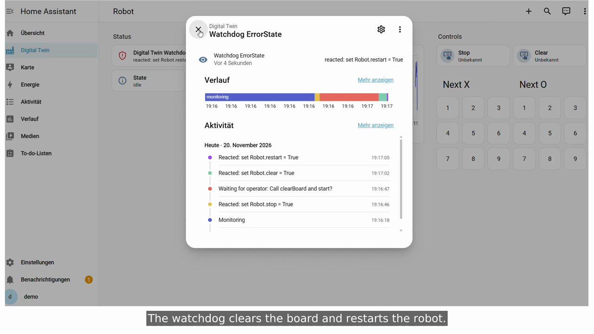

**No** ends the watchdog with the robot stopped; no answer within 5 minutes escalates. The alarm
card disappears 30 s after the watchdog run has ended.

#### Step 8: Overheat scenario

1. Back in AIDE, in the **Deploy & monitor** panel, choose the **Simulator scenario** `overheat`
   and click **Start scenario**. The panel shows *running: overheat* and the expected behavior.

   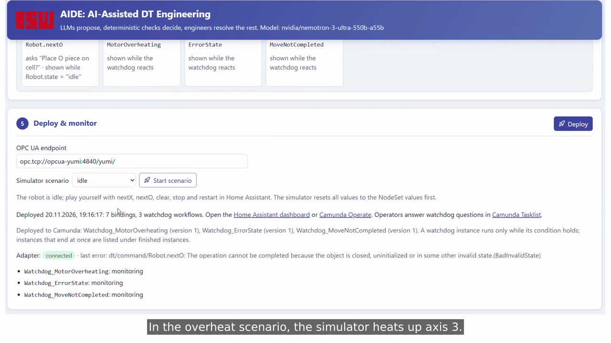

2. In Home Assistant, watch the gauge **Motor temperature**: axis 3 reaches 70 °C after 10 s and
   84 °C after 20 s. Above 80 °C, the watchdog *MotorOverheating* calls `Stop`; the alarm card
   shows *reacted: set Robot.stop = True* and the state `stopped`.

   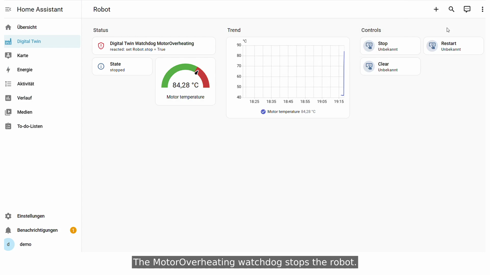

3. The robot stays stopped while the motor cools down (65 °C after 60 s). Below 60 °C (55 °C after
   90 s), the watchdog calls `Start`: the alarm card shows *reacted: set Robot.restart = True*, the
   state is `idle` again, and the watchdog instance ends.

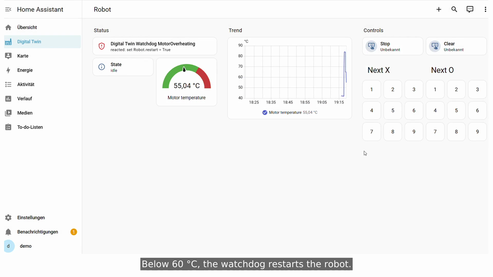

[Simulator scenarios](docs/simulator_scenarios.md) describes every scenario of the simulators,
including the other YuMi scenarios `overheat-persists`, `error` and `move-stuck`, and how the
watchdogs react to them.

### Camunda Operate

[Camunda Operate](http://localhost:8180/operate) (`demo` / `demo`) shows each watchdog run. Every
value change of a trigger attribute starts a watchdog run, so Operate also lists many short runs
that end at once. To find the runs that reacted, filter Operate by the flow node of a service task
or of an escalation.

### Other examples

The robot cell and the milling machine follow the same steps; choose them in step 1. Their binding
step differs in two points:

- **Value mappings.** Bind through a value mapping, as in step 2.3: in the robot cell
  `CncMachine.startCycle`, `CncMachine.coolantOn`, `Robot.stopMotion`, `Robot.resumeMotion` and
  `Conveyor.run`; in the milling machine `Program.feedHold` and `Program.abort`.
- **Unsupported nodes.** Greyed nodes at the top of the list are excluded only because AIDE does not
  support them, such as the getter method `GetBatteryLevel()` for `Robot.batteryLevel`; for them
  the reason is prefilled. In the robot cell, mark `Robot.batteryLevel` and `Cell.totalPower`
  (only the sum of three phases) as unbound. Watchdogs and dashboard cards must not use an unbound
  attribute, a fault rule that needs one stays an open case (`openrule`), and at runtime the
  adapter publishes no value for it, only its reason on `dt/unbound/<attribute>`.
- **Workflow requirements.** In the robot cell, the robot motor temperature is not a service
  attribute; it becomes a workflow requirement in step 3, so approve the binding again.

To add an example of your own, create a folder in `examples/` with the files of the use case and
add a simulator service for it to `compose.yaml`, like `opcua-yumi`, with its own port and the
volume `generated/runtime/scenario/<example>`. Without a simulator, upload the three input files in
step 1 and deploy against the endpoint of the real machine.

## Troubleshooting

```bash
docker compose ps             # service states
docker compose logs backend   # logs of one service, e.g. adapter or opcua-yumi
```

| Symptom | Check |
|---|---|
| A service is not healthy after `up` | `docker compose logs <service>`; free memory, disk space and ports |
| **Generate binding** fails with "GROQ_API_KEY is not set" (or MISTRAL_API_KEY, NVIDIA_API_KEY) | Set the key of `AI_PROVIDER` in `.env` and run `docker compose up -d --wait` again |
| groq, mistral or nvidia request failed (401, 404) | `AI_PROVIDER`, key and `AI_MODEL` in `.env` |
| Adapter shows a disabled binding | The node is missing on the server or has another data type than in the NodeSet |
| A watchdog does not react | Bound nodes in step 2, watchdog state in the tool, the run in Camunda Operate, `docker compose logs adapter` |

The engineering workspace is stored in `generated/workspace/` and the active deployment in
`generated/runtime/`.

### Rebuilding the MontiCore languages

The backend image copies the compiled languages from `languages/prebuilt/dtlang.jar`, so the build
needs no access to the MontiCore repository `nexus.se.rwth-aachen.de`. The jar does not update
itself: after changing anything in `languages/`, rebuild it in one of two ways.

**In Docker** (needs access to the Nexus): delete the jar and build the backend. Without the jar,
the image compiles the languages with Gradle. Then copy the new jar out of the image:

```bash
rm languages/prebuilt/dtlang.jar
docker compose build backend
docker create --name dtlang dt-backend:local
docker cp dtlang:/app/dtlang.jar languages/prebuilt/dtlang.jar
docker rm dtlang
```

**On the host** (needs Java 21 and Gradle 8; works offline once the Gradle cache holds MontiCore
7.9.0):

```bash
cd languages
gradle --offline cliJar       # drop --offline on the first run
cp build/libs/dtlang.jar prebuilt/dtlang.jar
```

If the Nexus is blocked or down, a build without the jar fails with
`Plugin [id: 'de.monticore.generator', ...] was not found`.

### Tests

The tests run in the built images, against the current sources, the language tool in
`languages/prebuilt/dtlang.jar` and the examples:

```bash
docker run --rm -v ./backend/app:/app/app:ro -v ./backend/tests:/app/tests:ro -v ./examples:/examples:ro -v ./languages/prebuilt/dtlang.jar:/app/dtlang.jar:ro -w /app dt-backend:local python -m unittest discover -s tests
docker run --rm -v ./adapter:/adapter:ro -w /adapter aide-adapter python -m unittest discover -s tests
```

On Windows, Git Bash rewrites the container paths; prefix the commands with `MSYS_NO_PATHCONV=1`
there, or run them in PowerShell.

## Architecture

<p align="center">
  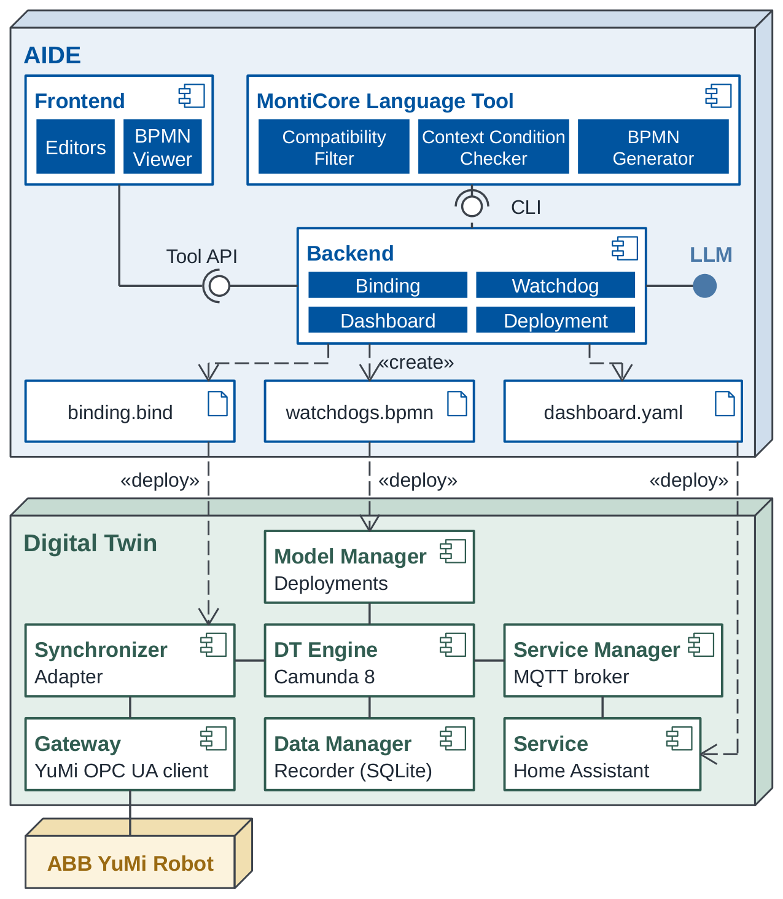
</p>

AIDE (top) creates the binding, the watchdogs and the dashboard. It deploys them to the digital twin
(bottom):

- Camunda 8 executes the watchdogs.
- The adapter reads the OPC UA nodes and records them in SQLite.
- An MQTT broker forwards the values.
- Home Assistant shows the dashboard.

The [development document](docs/development_document.md) describes the design in detail.

## License

AIDE is licensed under the [Apache License 2.0](LICENSE).

## Disclaimer of Warranty

Unless required by applicable law or agreed to in writing, Licensor provides the Work (and each
Contributor provides its Contributions) on an "AS IS" BASIS, WITHOUT WARRANTIES OR CONDITIONS OF ANY
KIND, either express or implied, including, without limitation, any warranties or conditions of
TITLE, NON-INFRINGEMENT, MERCHANTABILITY, or FITNESS FOR A PARTICULAR PURPOSE. You are solely
responsible for determining the appropriateness of using or redistributing the Work and assume any
risks associated with Your exercise of permissions under this License.

## Haftungsausschluss

Dies ist ein Forschungsprototyp. Die Haftung für entgangenen Gewinn, Produktionsausfall,
Betriebsunterbrechung, entgangene Nutzungen, Verlust von Daten und Informationen,
Finanzierungsaufwendungen sowie sonstige Vermögens- und Folgeschäden ist, außer in Fällen von grober
Fahrlässigkeit, Vorsatz und Personenschäden, ausgeschlossen.
